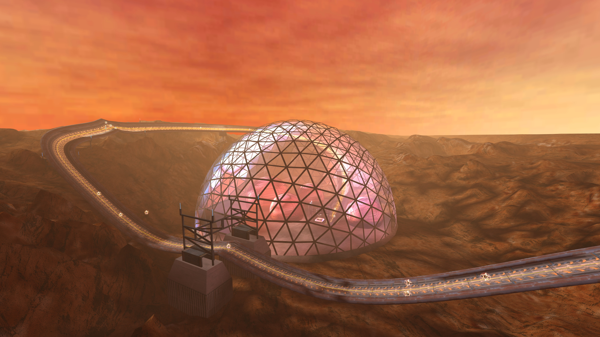

# Argon

A reimplementation of Quantum Redshift (Xbox), with a track viewer. It reads the game's own files
directly — no export step (except for the bik cutscenes). This has been almost fully done by claude.
Some earlier Ghidra was done by me, mostly UI for a 720p patch I never fully finished.

This is not meant to be a 1:1 implementation, most notably audio is not 100% correct. Some render bugs are not replicated either.



More screenshots in the images folder.

## New features
- Vulkan/DirectX 12 render (automatic fallback to DX12)
- Native resolution render, adapts to any aspect ratio
- High refresh rate support
- Fixes some bugs that were present in the original game
- Post AA + MSAA
- The original xbe is only required for the audio tables (HRTF) if you want the audio closer to the original Xbox.
- Two HRTF options, one that tries to mimic the original xbox and the MIT KEMAR one. Note that using more than 64 taps will load your CPU heavily.
- Multiple HUD sizes for HiDPI users (or users that just want a smaller HUD)
- OTF font support for sharp fonts across the UI
- Debug viewer, open any track and look around. Ideally to be converted into a proper track editor
- FPS, frame time, ram and vram meter
- Multilanguage support
- Some tooling to export tracks and ships so you can edit them in Blender
- Save game editor that supports both the decomp and the original Xbox save. Requires Xbox keys

## Game files
Put the Europe/USA disc's contents in `game_data` (`data`, `config`, `audio`, `Locale`, `media`, `default.xbe`, ...); argon
writes its profiles, ghosts and records to `save_data` next to it. `--game <folder>` points it elsewhere. The intro
videos, music and sounds can be converted with `tools\assets\convert_assets.py` (needs ffmpeg). For sharp text, see
[fonts/README.md](fonts/README.md).

For other languages other than English and Japanese, you need to use the European release (the USA release has garbage instead
of the actual translation, also Spanish is not available in any release).

## Controls
**F11** fullscreen, **F2** FPS meter, **F12** screenshot (PNG in `screenshots` next to `save_data`). In `argon_debug`: **F1** control panel, hold right mouse + WASD / Q / E to fly
the camera (Shift ×5).


## Build
Windows: Visual Studio 2022 (C++ workload) and the Vulkan SDK.
```
build.bat
```
Linux (untested): a C++20 compiler, CMake 3.24+, Ninja, the Vulkan SDK pieces and GLFW's X11 / Wayland packages.
```
./build.sh
```
This builds `argon` (the game) and `argon_debug` (the developer build: track editor, debug tools, command line).
`test.bat` / `./test.sh` build and run the tests. Details: [docs/argon/build.md](docs/argon/build.md).


## Documentation
| file | what |
|---|---|
| [docs/argon/build.md](docs/argon/build.md) | build requirements, folders, asset conversion, settings, tests |
| [docs/argon/editor.md](docs/argon/editor.md) | the developer build: the editor, how it matches the game, command line, known limits |
| [docs/argon/source.md](docs/argon/source.md) | the source layout |
| [docs/README.md](docs/README.md) | everything else, by subject: file formats, the game's systems, TODO, differences from the game |

## Licenses
The libraries are downloaded at build time (into `build/_deps`), each under its own license:

| library | version | license |
|---|---|---|
| [GLFW](https://github.com/glfw/glfw) | 3.4 | zlib/libpng |
| [Dear ImGui](https://github.com/ocornut/imgui) | 1.91.9 | MIT |
| [glm](https://github.com/g-truc/glm) | 1.0.1 | MIT (or the Happy Bunny License) |
| [nlohmann/json](https://github.com/nlohmann/json) | 3.11.3 | MIT |
| [miniaudio](https://github.com/mackron/miniaudio) | 0.11.21 | public domain (Unlicense) or MIT No Attribution |
| [dr_libs](https://github.com/mackron/dr_libs) (dr_flac, dr_mp3) | | public domain (Unlicense) or MIT No Attribution |
| [stb](https://github.com/nothings/stb) (stb_vorbis) | | public domain or MIT |
| [libogg](https://github.com/xiph/ogg) | 1.3.6 | BSD 3-clause |
| [libtheora](https://github.com/xiph/theora) | 1.2.0 | BSD 3-clause |

The MIT HRTF KEMAR Measurements are used [HRTF Measurements of a KEMAR Dummy-Head Microphone](https://sound.media.mit.edu/resources/KEMAR.html).
This data is copyrighted by MIT but free to be used, the resulting bin file is provided in the release.

Quantum Redshift, its data and `default.xbe` belong to their copyright holders (Curly Monsters and Microsoft) and are not part of this repo.
The fonts in `fonts` (MS PGothic, Square 721 Extended Bold) are commercial fonts under their owners' licenses, also not part of this repo.

To Microsoft/Curly Monsters or whatever IP holder Quantum Redshift belongs to, feel free to use this code if you intend to rerelease the game.

## Misc

Why Argon? Because its next to Neon in the periodic table, and Neon was the codename for Quantum Redshift. The other option was Clanker Vibeshift...
